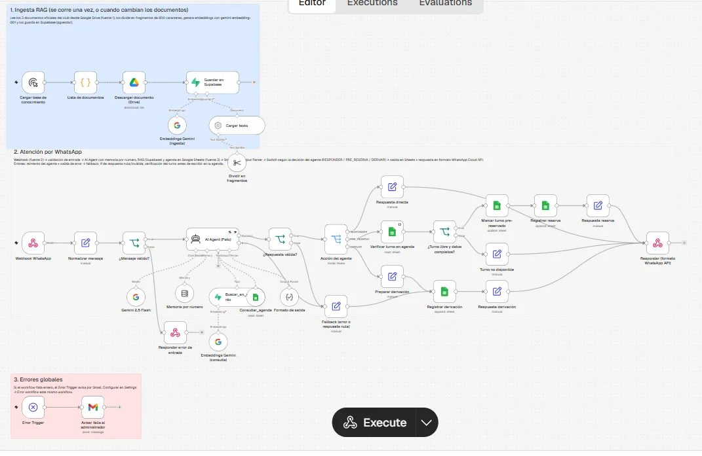
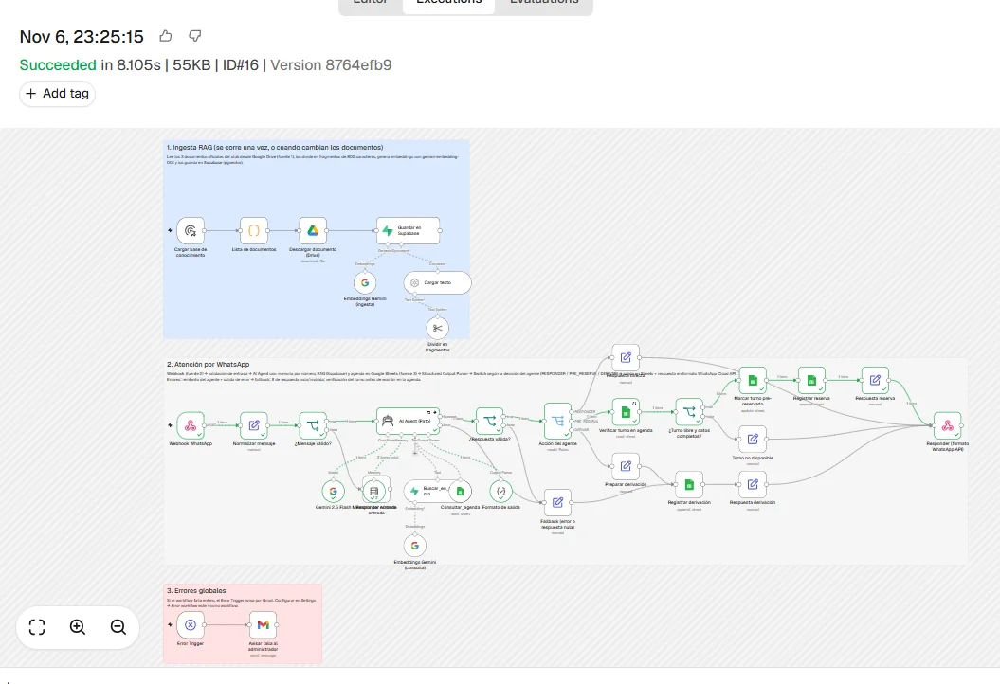
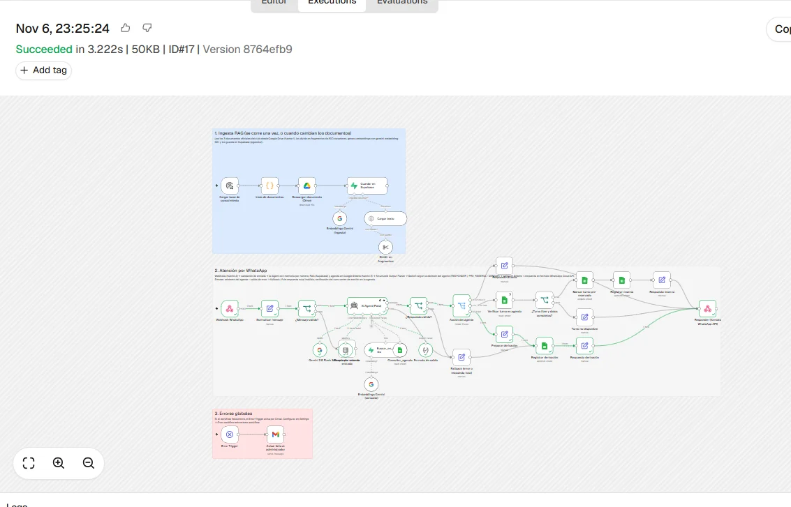

# Agente RAG de WhatsApp para Pádel Sur Club

**Proyecto Final · AI Automation (Coderhouse) · Gabriel Santone**

Asistente autónomo que atiende por WhatsApp a los clientes de un club de pádel (ficticio): responde consultas con información oficial recuperada por **RAG**, consulta la agenda real de canchas, deja **pre-reservas** en Google Sheets y **deriva al staff** lo que no puede resolver. Construido en **n8n** con **AI Agent + Gemini 2.5 Flash + Supabase (pgvector)**.

| Archivo | Contenido |
|---|---|
| `workflow-agente-rag.json` | Workflow exportado de n8n (ingesta RAG + atención + errores) |
| `README.md` | Este documento |
| `capturas/` | Canvas del workflow y ejecuciones de prueba exitosas |

---

## 1. Caso de negocio

### Proceso manual actual
En un club de pádel de 4 canchas, la recepción responde a mano los mensajes de WhatsApp: precios, horarios, reglas de cancelación, si hay cancha libre, y la toma de reservas. Son consultas **repetitivas**, llegan **todo el día** (incluso fuera del horario de atención) y obligan a una persona a revisar la agenda y los reglamentos en cada respuesta. Si nadie contesta rápido, el cliente reserva en otro club.

### Por qué es un buen candidato para Agente + RAG
- **Alto volumen y baja complejidad:** cerca del 70% de los mensajes son preguntas cuya respuesta ya está escrita (reglamento, precios, FAQ) o una consulta de disponibilidad.
- **La información cambia:** precios y políticas se actualizan. Con RAG basta con editar el documento en Drive y volver a correr la ingesta; no hay que tocar el prompt.
- **Requiere criterio:** cada mensaje exige decidir qué hacer (responder, reservar o derivar), y eso es una decisión, no solo generar texto.

### ROI estimado
**Supuestos** (club de tamaño medio, valores estimados):

| Variable | Valor |
|---|---|
| Conversaciones por día | 80 |
| Tiempo humano por conversación | 4 min |
| Costo de la hora de recepción | USD 5 |
| Conversaciones que resuelve el agente sin humano | 70% |

**Situación actual:** 80 × 4 min = 320 min/día ≈ **160 h/mes** de recepción dedicadas a WhatsApp.

**Con el agente:** se automatiza el 70% → **112 h/mes ahorradas ≈ USD 560/mes**.

| Costos mensuales | USD |
|---|---|
| API de Gemini (chat + embeddings) | ~20 |
| n8n Cloud Pro (50 €/mes; el plan Starter de 2.500 ejecuciones no alcanza para 80 conversaciones × varios mensajes) | ~58 |
| Supabase (plan gratuito, alcanza para este volumen) | 0 |
| **Total** | **~78** |

> El desarrollo y las pruebas se hicieron sobre la prueba gratuita de n8n Cloud; para operar en producción se presupuesta el plan Pro.

- **Beneficio neto:** USD 560 − 78 ≈ **USD 480/mes**.
- **Implementación:** ~25 h de desarrollo → se recupera en el **primer mes**.
- **Escala mejor que lo manual:** si el volumen se duplica, el costo humano se duplica, mientras que el del agente crece solo por tokens (centavos por conversación) y atiende 24/7 sin colas.

### Límites del ROI: cuándo deja de tener sentido
Cada conversación diaria automatizada ahorra ≈ 4 min × 70% × USD 5/h × 30 días ≈ **USD 7/mes**. Con USD 78/mes de costo fijo, el **punto de equilibrio es ~11 conversaciones por día**.
- Un club con **menos de ~11 mensajes diarios** no justifica la automatización: conviene responder a mano.
- Si la tasa de derivación supera ~70% (consultas muy particulares), el agente solo agrega un paso.
- Si el valor de la hora es casi nulo (por ejemplo, el dueño contesta en sus ratos libres), el ahorro es menor y pesa más la conveniencia que el dinero.

---

## 2. Arquitectura del workflow



El workflow tiene tres partes (separadas con sticky notes en el canvas):

**1. Ingesta RAG** (se corre una vez, o cuando cambian los documentos)
`Manual Trigger → Lista de documentos → Google Drive (descarga como texto) → Default Data Loader → Recursive Text Splitter (800/100) → Embeddings Gemini → Supabase Vector Store (insert)`

**2. Atención por WhatsApp**
`Webhook → Normalizar mensaje → If ¿Mensaje válido? → AI Agent → If ¿Respuesta válida? → Switch por acción → Google Sheets → Respond to Webhook`

El AI Agent tiene conectados:
- **Gemini 2.5 Flash** (modelo de chat).
- **Memoria por número** (Window Buffer, Session ID = número del remitente, últimos 10 mensajes).
- **Tool `Buscar_en_reglamento`:** Supabase Vector Store en modo *retrieve as tool* (top 4 fragmentos).
- **Tool `Consultar_agenda`:** Google Sheets, filtra la hoja *Agenda* por fecha y `estado = libre`.
- **Structured Output Parser:** obliga a devolver `respuesta`, `accion`, `motivo_derivacion` y `reserva`.

El **Switch** ejecuta la decisión del agente:
- `RESPONDER` → responde directo.
- `PRE_RESERVA` → vuelve a verificar el turno en la agenda, lo marca `pre-reservado` y agrega la fila en *Reservas*.
- `DERIVAR` → registra el caso en *Derivaciones* para el staff.

**3. Errores globales:** `Error Trigger → Gmail` al administrador.

### Entradas (3 fuentes distintas)
| Fuente | Nodo | Qué aporta |
|---|---|---|
| Webhook | `Webhook WhatsApp` | El mensaje del cliente (acepta el formato simple de prueba y el de WhatsApp Cloud API) |
| Google Drive | `Descargar documento (Drive)` | Reglamento, precios y políticas, preguntas frecuentes (base del RAG) |
| Google Sheets | `Consultar_agenda` / `Verificar turno en agenda` | Turnos libres y ocupados en tiempo real |

### Salidas (canal real)
- **Respuesta al cliente** con el formato del endpoint `/messages` de WhatsApp Cloud API (en producción se reemplaza el Respond por el nodo *WhatsApp Business Cloud → Send Message*).
- **Google Sheets:** fila en *Reservas* (pre-reserva para que el staff confirme), turno marcado en *Agenda* y fila en *Derivaciones* (cola de casos para el staff).
- **Gmail:** aviso al administrador si el workflow falla.

---

## 3. Elección del modelo: nube (Gemini 2.5 Flash)

Para el agente principal elegí un modelo **en la nube**, Google **Gemini 2.5 Flash**, en lugar de un modelo local con Ollama.

| Criterio | Nube (Gemini 2.5 Flash) | Local (Ollama) |
|---|---|---|
| **Costo según volumen** | ~80 conversaciones/día ≈ USD 20/mes en tokens; se paga solo lo que se usa | Requiere un servidor con GPU encendido 24/7 (más de USD 100/mes en la nube), muy por encima del gasto en API para este volumen |
| **Privacidad** | Los datos son de bajo riesgo: nombre, teléfono y turno. No se procesan pagos, DNI ni datos sensibles (el prompt prohíbe pedirlos) | Ventaja real solo si hubiera datos sensibles o regulados, que no es el caso |
| **Latencia y calidad** | Respuestas de 3 a 8 s con dos tools, buen *tool calling* y buen español rioplatense | Los modelos que corren en hardware modesto (7–8B) fallan más al usar tools y al respetar el JSON de salida |
| **Independencia del proveedor** | Dependencia mitigada: reintento automático, fallback que deriva al staff y cambio de proveedor en un clic (OpenAI o Anthropic con el mismo Agent) | Total independencia, pero con mantenimiento propio (actualizaciones, caídas del servidor) |

**Por qué Gemini y no OpenAI o Anthropic:** el mismo proveedor ofrece el modelo de chat y el de **embeddings** (una sola credencial), tiene muy buen *tool calling* y el costo por token es de los más bajos, lo que importa en un canal de alto volumen y mensajes cortos. La temperatura es **0.2** para que las respuestas sean consistentes y no invente datos.

**Cuándo convendría local:** si el club creciera a una cadena con miles de conversaciones diarias, o si el agente manejara datos sensibles (por ejemplo, historia clínica en un centro de kinesiología), un servidor propio con Ollama pasaría a ser competitivo en costo y obligatorio en privacidad.

---

## 4. Estrategia de Vector Store y Embeddings

- **Vector Store: Supabase (PostgreSQL + pgvector).**
  - Es una base gestionada, con plan gratuito suficiente para este volumen y nodo nativo en n8n.
  - Los vectores persisten: a diferencia del *In-Memory Vector Store*, no se pierden al reiniciar n8n.
  - Es SQL estándar (tabla `documents` + función `match_documents`), con **Row Level Security** activado; n8n accede con la clave secreta del servidor.
  - Frente a Pinecone, evita sumar otro proveedor y deja los datos en un Postgres que se puede consultar, exportar o respaldar.
- **Embeddings: `gemini-embedding-001`** (3.072 dimensiones). Es multilingüe y funciona muy bien en español; usa la misma credencial que el modelo de chat. La **misma** configuración de embeddings se usa en la ingesta y en la consulta (si no, los vectores no son comparables).
- **Fragmentación:** Recursive Character Text Splitter de **800 caracteres con 100 de solapamiento**. Cada fragmento contiene una o dos preguntas o reglas completas, y el solapamiento evita cortar una regla a la mitad. Cada fragmento guarda en `metadata.fuente` el documento de origen.
- **Recuperación:** **top 4** fragmentos por similitud coseno, suficiente contexto sin llenar el prompt.
- **Escalabilidad:** con 3.072 dimensiones pgvector no permite índices HNSW/IVFFlat (límite de 2.000), pero con unas decenas de fragmentos la búsqueda secuencial tarda milisegundos. Si la base creciera a miles de documentos, generaría los embeddings con `outputDimensionality = 768` y agregaría un índice HNSW.

---

## 5. Por qué AI Agent con RAG y no un nodo de IA simple

Un nodo de IA simple (Basic LLM Chain) recibe un texto y devuelve otro en un solo paso. Este proceso necesita más:

1. **Decidir qué herramienta usar y cuándo.** Ante "¿hay cancha mañana a la noche?" el agente consulta la agenda. Ante "¿hasta cuándo puedo cancelar?" busca en el reglamento. Ante "quiero reservar" puede usar las dos. Una cadena fija no sabe qué consultar.
2. **Varios pasos por mensaje:** consultar agenda → ofrecer opciones → pedir el nombre → confirmar. Necesita iterar con tools y recordar la conversación (memoria por número).
3. **Tomar una decisión que cambia el flujo:** el agente devuelve `RESPONDER`, `PRE_RESERVA` o `DERIVAR` y el **Switch** ejecuta acciones distintas sobre datos reales (escribir en la agenda, registrar una reserva o abrir un caso para el staff).
4. **RAG en lugar de un prompt gigante o una consulta estática:**
   - Las respuestas salen de los documentos oficiales: el agente no inventa precios ni políticas, y si el RAG no encuentra la respuesta, deriva.
   - Si cambian los precios, se edita el doc en Drive y se reindexa, sin tocar el workflow.
   - Una consulta estática (por ejemplo, un buscador por palabra clave) no entiende "¿cuánto sale jugar a la nochecita?" ni combina la regla con la disponibilidad del día.

---

## 6. Manejo de errores y casos límite

### Punto de falla 1: el modelo o el Vector Store no responden (caída, timeout, cuota)
- El nodo **AI Agent** tiene **Retry on Fail** (2 intentos, 2 s entre intentos).
- Si igual falla, su **salida de error** (*On Error → Continue using error output*) va al nodo **Fallback**. Ese nodo arma una respuesta segura ("te paso con alguien del staff"), registra el caso en *Derivaciones* con el motivo técnico y responde al webhook. **El cliente nunca queda sin respuesta.**
- Si falla una **tool** (Supabase o Sheets) durante el razonamiento, el system prompt indica derivar al staff en lugar de improvisar.
- Si falla cualquier otro nodo, el **Error Trigger** envía un mail al administrador con el nodo, el error y el link a la ejecución.

### Punto de falla 2: respuesta nula, mal formada o que interpreta mal la instrucción
- El **Structured Output Parser** obliga al LLM a devolver el JSON `{respuesta, accion, motivo_derivacion, reserva}`.
- El If **¿Respuesta válida?** verifica que `respuesta` no esté vacía y que `accion` sea exactamente `RESPONDER`, `PRE_RESERVA` o `DERIVAR`. Si no, el caso va al mismo **Fallback**.
- **Validación antes de tocar datos reales:** aunque el agente diga `PRE_RESERVA`, el flujo **vuelve a leer la agenda** y el If **¿Turno libre y datos completos?** comprueba que el turno siga `libre`, que haya nombre y que la fecha no sea pasada. Solo así marca el turno y registra la reserva; si no, responde que el turno ya no está disponible. Esto evita reservas dobles o inventadas por el modelo.

### Casos límite adicionales
- **Entrada inválida:** si el webhook llega sin número o sin texto, el If **¿Mensaje válido?** responde **HTTP 400** sin gastar tokens.
- **Ambigüedad y fuera de alcance:** el system prompt obliga a hacer una sola pregunta de aclaración, a no suponer fecha ni hora y a rechazar con amabilidad temas ajenos al club.
- **Pedidos sensibles:** reclamos, cobros, reembolsos, clases y torneos se derivan siempre al staff.

---

## 7. Pruebas realizadas

Pruebas por HTTP contra la URL de producción del webhook (6/11/2026):

| # | Mensaje del cliente | Decisión | Resultado |
|---|---|---|---|
| 1 | "¿Cuánto sale el turno a la noche y hasta cuándo puedo cancelar sin pagar?" | `RESPONDER` | Respondió con datos del RAG: $44.000 desde las 18:30 y cancelación sin cargo hasta 12 h antes (4,4 s) |
| 2 | "Quiero reservar para mañana a la noche, cancha techada" | `RESPONDER` | Consultó la agenda: sin techadas libres a la noche, ofreció 3 alternativas reales (6,8 s) |
| 3 | "Dale, la de las 14 en Cancha 1. A nombre de Martín Gómez" | `PRE_RESERVA` | Verificó el turno, lo marcó `pre-reservado` en *Agenda* y agregó la fila en *Reservas* (8,4 s) |
| 4 | "Quiero hablar con una persona, me cobraron dos veces el turno del martes" | `DERIVAR` | Fila en *Derivaciones* con motivo "problema de cobro (doble cobro)" (3,5 s) |
| 5 | Webhook sin `text.body` | Validación | HTTP 400 "Mensaje inválido" |

**Ejecución exitosa de la pre-reserva** (camino Agent → Switch → verificación → Agenda → Reservas → respuesta):



**Ejecución exitosa de una derivación al staff:**



Ejemplo de llamada de prueba:

```bash
curl -X POST https://<tu-instancia>.app.n8n.cloud/webhook/padel-rag \
  -H "Content-Type: application/json" \
  -d '{"from":"5491155550001","text":{"body":"Hola! ¿Cuánto sale el turno a la noche?"}}'
```

Respuesta:

```json
{"messaging_product":"whatsapp","to":"5491155550001","type":"text",
 "text":{"body":"Hola! Los turnos que empiezan desde las 18:30 salen $44.000. ..."},
 "accion":"RESPONDER"}
```

---

## 8. System Prompt completo del agente

```text
ROL
Sos "Pato", el asistente de WhatsApp de Pádel Sur Club (club ficticio). Atendés a clientes que quieren reservar una cancha o tienen dudas sobre el club.

FECHA Y HORA ACTUAL
{{ $now.setZone('America/Argentina/Buenos_Aires').setLocale('es').toFormat("cccc dd/MM/yyyy HH:mm") }} (hora Argentina). Usala para interpretar "hoy", "mañana" o "el sábado".

ALCANCE: QUÉ PODÉS HACER
1. Responder preguntas sobre el club (horarios, precios, reglamento, pagos, cancelaciones, instalaciones).
2. Consultar turnos libres y dejar una PRE-RESERVA.
3. Derivar al staff lo que no podés resolver.

HERRAMIENTAS
- Buscar_en_reglamento: busca en los documentos oficiales del club (reglamento, precios y políticas, preguntas frecuentes). Usala SIEMPRE antes de responder cualquier pregunta sobre el club. Respondé solo con lo que diga el resultado.
- Consultar_agenda: devuelve los turnos LIBRES de una fecha (formato AAAA-MM-DD). Usala SIEMPRE antes de ofrecer o confirmar un horario. Nunca digas que hay lugar sin consultarla.

CÓMO TOMAR UNA RESERVA
1. Pedí los datos que falten: día, horario y nombre de quien reserva. Si no dice cancha, preguntá si prefiere techada o descubierta.
2. Consultá la agenda y ofrecé hasta 3 opciones libres cercanas a lo pedido.
3. Cuando el cliente elija un turno libre y tengas el nombre, devolvé accion PRE_RESERVA con todos los datos de la reserva (fecha AAAA-MM-DD, hora_inicio HH:MM, cancha exactamente como figura en la agenda, por ejemplo "Cancha 1", y el precio de la agenda). Aclarale que queda PRE-RESERVADA hasta que el staff la confirme por este chat.

CUÁNDO DERIVAR AL STAFF (accion DERIVAR)
- El cliente pide hablar con una persona.
- Reclamos, problemas de cobro, reembolsos o pedidos de excepción a las políticas.
- Clases, torneos, eventos, cumpleaños o turnos fijos (los gestiona el staff, aunque el reglamento los mencione).
- La herramienta Buscar_en_reglamento no devuelve la respuesta, o alguna herramienta falla.
En esos casos respondé: "Te paso con alguien del staff, en breve te escriben por acá" y completá motivo_derivacion en pocas palabras.

AMBIGÜEDAD Y CASOS FUERA DE ALCANCE
- Si el mensaje es ambiguo (por ejemplo "quiero para el finde"), hacé UNA sola pregunta para aclarar. No supongas fecha, hora ni cancha.
- Si el mensaje no tiene nada que ver con el club, decí amablemente que solo podés ayudar con reservas y consultas de Pádel Sur Club (accion RESPONDER).
- Si no entendés el mensaje, pedí que lo repitan con otras palabras.

LÍMITES (lo que NO hacés)
- No inventes precios, horarios, políticas ni disponibilidad.
- No confirmes reservas como definitivas ni cobres.
- No pidas datos de tarjeta, claves ni DNI.
- No prometas descuentos, reembolsos ni excepciones.

TONO (canal WhatsApp)
Español rioplatense, cercano y amable, tratando de "vos". Mensajes de 3 a 4 líneas como máximo, sin markdown ni listas largas. Como mucho 1 emoji.

FORMATO DE SALIDA
Respondé siempre con el JSON del formato indicado:
- respuesta: el mensaje para el cliente.
- accion: exactamente RESPONDER, PRE_RESERVA o DERIVAR.
  RESPONDER = respondiste una consulta o te falta un dato.
  PRE_RESERVA = el cliente eligió un turno libre y tenés su nombre.
  DERIVAR = se pasa al staff.
- motivo_derivacion: solo si accion es DERIVAR; si no, "".
- reserva: solo con datos si accion es PRE_RESERVA; si no, campos vacíos y precio 0.
```

---

## 9. Cómo reproducirlo

1. **Supabase:** crear un proyecto y ejecutar en el SQL Editor:
   ```sql
   create extension if not exists vector;
   create table documents (id bigserial primary key, content text, metadata jsonb, embedding vector(3072));
   create or replace function match_documents (query_embedding vector(3072), match_count int default null, filter jsonb default '{}')
   returns table (id bigint, content text, metadata jsonb, similarity float) language plpgsql as $$
   #variable_conflict use_column
   begin
     return query select id, content, metadata, 1 - (documents.embedding <=> query_embedding) as similarity
     from documents where metadata @> filter order by documents.embedding <=> query_embedding limit match_count;
   end; $$;
   -- Seguridad: sin políticas públicas, solo la clave secreta del servidor (la que usa n8n) accede a la tabla
   alter table documents enable row level security;
   ```
2. **n8n:** importar `workflow-agente-rag.json` y asignar las credenciales de Google Gemini (API key propia), Supabase, Google Drive, Google Sheets y Gmail.
3. **Google:** subir los documentos del club a Drive y crear la planilla con las hojas *Agenda* (`fecha, dia, hora_inicio, cancha, tipo, precio, estado`), *Reservas* y *Derivaciones*; reemplazar los IDs en los nodos.
4. Ejecutar una vez la rama **1. Ingesta RAG** (desde el nodo *Guardar en Supabase → Execute step*). No repetirla: cada corrida vuelve a insertar los fragmentos y los duplica.
5. En *Settings → Error workflow* elegir este mismo workflow, **publicar** y enviar mensajes al webhook de producción.

> Datos del club, documentos y personas son ficticios, creados con fines académicos.
